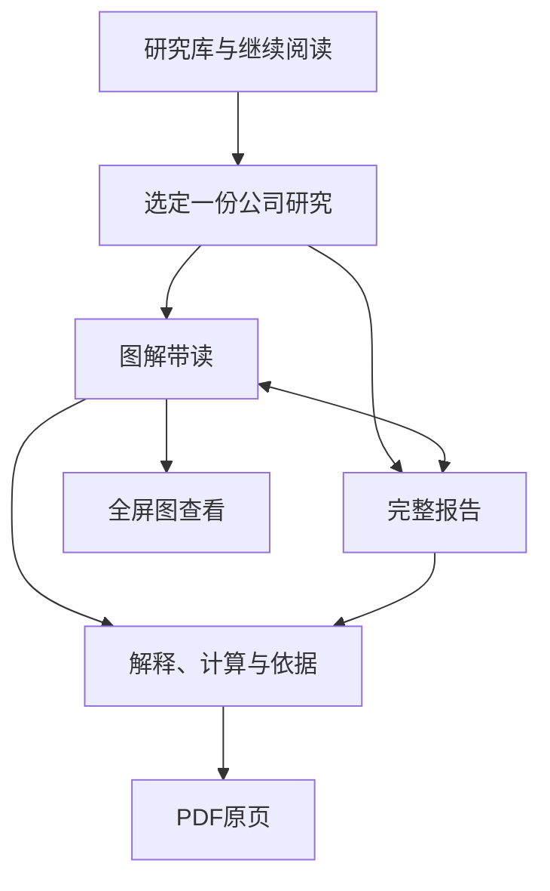
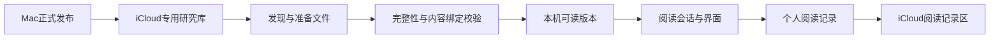

# 展示 App 架构探索备忘（待技术方案阶段评估）

2026-11-14。本文件保存产品 spec 阶段的早期探索材料。用户后续已进入技术方案讨论，并选择按复杂度和共同变化聚合 Module。当前推荐方案见[GitHub 技术提案 #4](https://github.com/GRHISMY/InvestmentShowcasePlatform/issues/4)及[展示 App 技术方案文档](display-app-technical-plan.md)，尚待整体确认。本文件中的早期模块、接口和实现细节仍为候选，未据此修改生产代码。

产品范围以 [GitHub 产品规格 #3](https://github.com/GRHISMY/InvestmentShowcasePlatform/issues/3) 为准；参考对象与探索依据见[CompanyLens 参考记录](companylens-reference.md)。本备忘不直接授权实施或固定当前原型的架构。

## 当前架构评估目标

用户明确以降低复杂度为代码架构设计的核心目标：代码库应有清楚的模块，遇到改动能明确找到负责的模块，模块内部逻辑容易理解。用户已选择以复杂度与共同变化作为主要划分准则，业务活动检验完整流程，领域模型统一概念，功能清单检查遗漏。比较方案时重点检查共同规则是否集中、Interface 是否简洁、普通改动需要理解及修改多少地方。下文四项职责划分仍保留为早期候选。

## 已讨论的产品方向

1. 首页为研究库，按公司进入研究，并提供继续阅读入口。
2. 手机以文字、图中标签及点击区域清楚可用为先，页面允许纵向滚动。
3. 图解与完整报告是同一份研究的两种阅读方式，互相关联，各自保留位置。
4. 复杂图可打开同一张图的全屏查看，支持放大与拖动，返回时保留焦点。
5. 启动回到最后的主阅读模式和位置；计算、依据与 PDF 也保存位置，在再次进入时恢复。
6. Mac mini 完成分析并发布研究包，iCloud 传递，手机负责展示。现有 SQL、研究方法与研究生成流程沿用。
7. 使用同一 Apple 账号下的普通 iCloud Drive 专用文件夹。iPhone 首次通过系统文件界面选定目录，之后保存访问授权，启动或回到前台时检查更新。
8. 自动准备新版，在研究库显示更新；正在阅读的旧版继续保持，主动切换或重新进入该公司的研究时才采用完整就绪的新版。
9. 个人阅读记录通过 iCloud 跨设备同步，并与 Mac 发布的研究包分开保存。

已有产品共识继续适用：业务全貌先行，带读并允许自由探索，关键未知与重要反证留在主线；各公司主线、图形组合和数量由研究决定。见[阅读共识](company-research-visual-reading.md)与[现有数据职责](company-study-data.md)。

## 候选体验关系（入口与动线待打磨）

全屏图和详情页返回其明确的来源位置。图解与报告的关联使用研究中的结论、计算和证据身份；同一判断可能对应多个图解位置，优先返回刚才的来源，没有明确来源时列出可选位置。没有对应图解的结论继续在完整报告中阅读，不为联动补造图形或研究关系。

## 候选的四项展示职责（未定稿）

这四项是同一个原生 App 内的职责划分，沿用 SwiftUI、PDFKit 与现有 Core 读取器。

| Module | Interface 负责提供什么 | 内部处理什么 |
| --- | --- | --- |
| 研究库资料管理 `StudyLibrary` | 研究条目、各版本可用状态、准备并打开指定版本 | iCloud 目录授权、发现变更、文件下载、清单与字节校验、本机完整副本 |
| 阅读记录 `ReadingProgressStore` | 保存和读取某版本的图解、报告及详情位置 | 本机先保存、iCloud 同步、各设备记录合并、记录格式与版本身份检查 |
| 阅读会话 `StudySession` | 当前研究版本、阅读模式、当前位置、打开详情、切换模式、返回 | 主线历史、焦点、两种模式的位置、详情来源和恢复策略 |
| 展示界面 | 展示研究库、图解、报告和共用详情，报告用户操作 | 字体与排版、图形布局、滚动、全屏图视口、计算与 PDF 展示 |

研究库只向阅读会话交付一份完整可读的研究包。阅读界面调用阅读会话的少量动作，不直接处理 iCloud 下载、目录扫描或文件校验。

`StudySession` 是导航与当前阅读状态的唯一管理者；`ReadingProgressStore` 负责保存与同步这些位置。恢复记录时，场景、焦点和正文位置是否适用于当前研究包，由会话结合现有读取器判断。现有 `VisualStudyState` 的场景历史和焦点恢复可作为会话内部实现保留，不再由页面各自维护互不相干的导航状态。

## 候选的研究包准备方案

Mac 在已有正式发布之后，将完整成果分发到 iCloud；分发步骤可以维护轻量的版本目录清单，用于列出公司、研究期间、资料截止日期和正式版本。该清单不保存第二份公司分析。分析工作区和 SQL 不成为手机的运行依赖。

建议的目录职责是“已发布研究包”和“个人阅读记录”两部分。研究包按版本保留；阅读设备只读研究包，个人位置写入独立记录区。具体目录名称在实施时确定。

普通 iCloud Drive 目录可由系统文件选择器授权，授权覆盖其子目录及后续新增内容，并可保存为下次使用的书签；失效时重新选定目录。[Apple：目录访问](https://developer.apple.com/documentation/uikit/providing-access-to-directories)

iCloud 中发现文件信息时，内容可能尚未在手机上下载完成。因此资料管理必须将“发现、准备中、校验中、可读、需重试”区分开；文件准备好并核对现有清单后，才对阅读界面开放该版本。[Apple：iCloud 文档同步](https://developer.apple.com/documentation/uikit/synchronizing-documents-in-the-icloud-environment)

本机完整副本用于稳定阅读和离线使用，可以从正式研究包重新准备。新版本先写入独立的候选目录，完整校验后标记为就绪；当前阅读会话及其 PDF 仍在使用的旧目录保持有效，不能在新版准备时直接覆盖或清理。某一份研究准备失败不会阻止其他研究打开。研究库显示的期间与资料截止日期来自正式包。

## 候选的版本与阅读位置规则

一次阅读会话固定到一个明确版本。新版已就绪时显示更新入口；当前图、报告、计算与 PDF 始终来自同一版本，切换版本作为一次明确的重新打开操作。

后续功能讨论已确认：点击“继续阅读”时，回到原版本最近一次实际阅读位置；“阅读新版”是另一个明确动作。跨设备记录默认按最近一次实际阅读恢复，主动回看也会更新位置，不自动采用最远进度。

引用定位与 PDF 续读分开：明确核对引用时打开引用原页，同时保留 PDF 上次停留处。向前阅读从当前内容继续，返回则回到实际来源；相关图解存在多个位置时供读者选择。主线末尾保留最后内容，提示已经到达末尾，由读者选择后续去向。

阅读记录按研究版本和阅读编排身份保存，至少区分：

- 图解：场景、焦点、主线历史及页面位置。
- 完整报告：判断或章节、正文位置。
- 详情：计算、依据及各份 PDF 的物理页。
- 最近的主阅读模式，用于 App 重启后恢复。

跨设备记录以场景、焦点、判断、正文段落及 PDF 页等内容位置为主，同一设备可另记本地滚动偏移；另一尺寸的屏幕按内容位置恢复，而不是直接套用原设备的像素坐标。全屏图与主阅读共享图和焦点，全屏的缩放及平移视口单独保存。

拟采用的默认恢复规则：新版没有有效记录时从全貌开始，保留旧版的位置；云端记录到达时更新“继续阅读”的候选位置，当前正在阅读的设备保持原处。按设备分开保存记录，合并时保留各设备的有效位置，默认提供最近一次有效主阅读位置；相同时间使用稳定设备标识确定顺序，其他设备的位置仍可选择。弹层是否打开、下载状态等暂态不作为跨设备的启动入口。

研究包身份与 PDF 路径由当前包提供，不能再使用固定的全局 Bundle 目录。这样切换公司或研究版本后，原页仍属于打开的那一份研究。

## 图、正文与详情的待评估组织

主阅读页保持明确顺序：当前问题、图、焦点说明、关键未知或反证、深入查看入口、主线导航。长内容由滚动承载；全屏查看器放大同一张图，不另行删减或改写经济关系。

两种阅读方式共用计算、依据与 PDF 查看界面，详情地址明确区分判断、计算、证据和来源页身份。现有报告路由里的 calculation 参数实际上是判断 ID，重构时需与真正的计算 ID 分开，避免同名地址指向不同内容。

图解与正文的交叉定位可以使用现有的结论引用；计算沿既有输入事实、证据和来源页引用访问 PDF。现有 `ResearchLibrary`、`ReadingLibrary` 的读取与绑定检查继续使用；资料管理补齐分发包及 PDF 字节完整性检查。

## 技术方案阶段的验证输入

- 在研究库打开不同公司或版本后，图文、计算和 PDF 始终属于选定版本；无图解编排的有效包仍可完整报告阅读。
- 从一个图解焦点进入计算、依据、PDF，逐层返回后保留来源焦点和页面位置；在图解与报告之间跳转也保持正确上下文。
- 窄屏、大字体、长解释、多项计算输入和密集关系图都能阅读与操作；全屏图关闭后返回原位置。
- iCloud 仅同步到部分文件、授权失效、更新校验失败或离线时，状态清楚，已有完整版本继续可读。
- 阅读期间新版本到达不会改变当前页面内容；切换版本后使用该版本自己的阅读记录。
- 两个设备之间可继续同版本阅读；迟到的云端位置不会将正在使用的页面跳走。

数据绑定和导航行为通过现有 Core 的 Interface 及新的研究库、阅读会话 Interface 验证；真实 iCloud、跨设备记录、排版、手势和 PDF 返回链在 iPhone/iPad 上验收。以上是下一阶段验收设计，不是本轮已经执行的测试结果。
