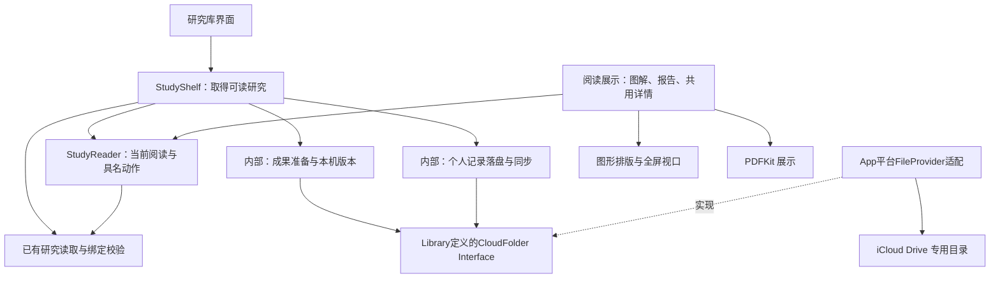

# 展示 App 技术方案提案

状态：研究库、阅读核心与展示三项职责基线及产品行为已确认；Interface 已展开复核，待整体技术方案确认。2026-11-14。

产品依据为 [GitHub 规格 #3](https://github.com/GRHISMY/InvestmentShowcasePlatform/issues/3)。用户已选择：按需要共同理解、共同修改的规则聚合复杂度，用小而清楚的 Interface 形成深 Module；业务活动用于检查完整流程，领域模型统一概念，功能清单检查覆盖。本方案没有修改 App 生产代码。

## 核心建议

采用两个行为 Module：**研究库 `StudyShelf`** 与 **阅读核心 `StudyReader`**；另将 SwiftUI、图形和 PDFKit 组织为职责明确的**展示 Module**。现有研究读取与绑定校验继续作为具体实现使用。

不是将十一项功能做成十一个技术 Module。资料是否可读、当前是哪一版、返回哪里、引用与续读如何区分等规则，各自在明确位置实现一次。展示中的全貌、图解、报告、计算、依据和 PDF 可以有独立文件，但不各自维护同一套导航、版本和阅读记录规则。

这里的 Module 是代码职责，不要求增加多个 Swift Package、依赖注入框架或每种能力一个 protocol。先沿用现有原生工程和 Core 测试组织。

## 方案比较

本轮独立比较了三种 Interface：

| 方案 | 外部形状 | 优点 | 认知与修改成本 |
| --- | --- | --- | --- |
| A：统一阅读体验 | 一个 `ReadingExperience`，输出有限内容帧，接收其提供的动作 | 页面少学上下文，版本、导航和恢复规则集中 | 动作间接性增加静态查找和调试成本；实施时需要防止仅追求方法少而扩大统一入口的概念数量 |
| B：独立阅读能力 | 图解、报告、核对、返回路径、记录、资料库等具体 Module | 各种阅读方式内部差异明确，独立变化容易定位 | 调用者需要理解更多 Interface；跨方式阅读需要持续维护多个 Module 的协作约定 |
| C：研究库交付可读研究 | `StudyShelf` 打开一个 `StudyReader`，页面展示当前内容并调用具名动作 | 常见调用简单；资料 I/O 与阅读语义分开；共享规则集中 | 需要维护有限的显示投影；Shelf 内部要分清资料准备与记录同步，Reader 内部也需明确规则归属 |

推荐 C。保留 A 的规则集中与 B 的具类型身份，在 C 内部按实际复杂度组织实现，不将所有内部辅助类型提升为页面必须协调的公开 Module。

用户已确认这一职责基线。具体契约分别见[阅读核心 Interface](reader-core-interface.md)、[研究库 Interface](study-shelf-interface.md)和[展示 Interface](presentation-interface.md)。这些是同一方案的细化，不增加新的主要 Module。

## Module 与依赖方向



研究库依赖阅读核心的输入输出契约，可以创建阅读器；阅读核心不依赖研究库、iCloud 或记录文件格式的传输细节。共同的研究身份、阅读位置和有效研究内容是具体值类型，各自放在拥有其含义的 Module 中，不建立装入所有类型的通用 Shared 层。

`CloudFolder` Interface 由 Library 定义，App 的平台代码提供生产适配，由组合入口注入；Core 不导入 App。代码依赖为 Library → Reading → Content，Library → Content，App → Library/Reading，平台适配 → Library 定义的外部依赖契约。运行时读取器调用注入的记录接收函数，不产生 Reading 对 Library 的代码依赖。

## 十一类功能怎样落到 Module

| 功能 | 主要规则归属 | 展示配合 |
| --- | --- | --- |
| 接收研究成果 | Shelf：发现、准备与失败恢复 | 显示状态与操作入口 |
| 浏览研究库及选择版本 | Shelf：可用条目、继续原版、明确打开版本 | 公司与版本入口 |
| 认识研究全貌 | Reader：取当前研究的全貌及覆盖信息 | 全貌排版 |
| 带读与自由探索 | Reader：当前位置、前进、实际来源和末尾 | 当前问题及导航动作 |
| 点图理解问题 | Reader：有效焦点、说明、限制与反证 | 图形选择反馈和说明排版 |
| 舒适阅读与复杂图 | Reader：同图与同焦点；展示：布局和视口 | 自然高度、滚动、缩放与拖动 |
| 完整报告与图文联读 | Reader：全部判断、正文位置、相关目标 | 图解和报告各自的阅读样式 |
| 核对计算 | Reader：结果、输入、限制与完整来源 | 共用计算阅读视图 |
| 核对依据 | Reader：出处、摘录、反证及多处引用 | 共用依据阅读视图 |
| 完整 PDF | Reader：引用或续读目的；展示：PDFKit | 原页、前后文、缩放和返回 |
| 中断与跨设备继续 | Shelf：记录交换与排序；Reader：位置含义与有效恢复 | 继续入口及有效位置报告 |

功能可以协作多个 Module，规则的定义位置保持单一。比如 PDFKit 负责怎样缩放，Reader 负责为何打开某一页，两者变化原因不同。

### 研究库 StudyShelf

对调用者提供：研究条目与版本状态、关联研究目录、刷新或重试、继续原版本、明确打开指定已就绪版本。

内部包含两项具体实现：

- **成果准备**：发现版本、请求文件可用、下载到候选目录、验证完整性与研究绑定、形成不可变本机版本、保留仍在使用的目录。
- **个人记录**：本机保存、云端读取与写入、去重、按真实阅读发生时间排列候选，保留各设备记录。它不解释某个焦点或段落在研究中的业务含义。

两者共享目录授权和系统文件访问，但有独立工作状态与重试计划。记录同步失败不阻止研究准备，研究下载失败也不阻止本机保存位置；研究文件只读，个人记录写入独立区域。

记录接收链明确为：受理实际阅读位置 → 更新本机内存候选 → 按本设备单调序号串行落盘 → 异步同步。旧写入的完成不能覆盖较新记录；本机保存结果和云同步结果分别反馈，保存失败保留待重试状态并提示读者。切换研究和回到后台时，共同宿主请求完成待保存位置，页面不自行 await、flush 或重试。异常终止前尚未成功落盘的位置不能宣称已持久保存。

`continueReading` 根据最近实际阅读记录找到明确的原版本，然后准备该版本；缺失时显示原版本未就绪并允许重试，不能改开最新版本。`readVersion` 是明确打开另一版本的动作。

### 阅读核心 StudyReader

对调用者提供：固定研究版本、已经解析好的当前内容、当前位置、相关内容入口、返回与前进状态，以及具名阅读动作。

内部按规则组织：

- **内容解析与关联**：将已有读取器的结果形成图解、报告、解释、计算、依据和 PDF 的显示内容；建立零个、一个或多个关联目标。
- **阅读导航**：当前模式、场景和焦点、主线前进、访问来源、返回恢复、主线末尾状态。
- **原文打开规则**：引用定位与 PDF 续读的目的、目标页及各自位置记录。
- **阅读位置**：产生实际阅读记录，检查恢复位置是否适用于当前研究；区分主阅读位置和详情位置。

这些是具体内部类型，不为每一项自动增加 protocol 或一层转发。核心不新增财务分析、不重新计算研究结论，也不选择新的公司主线。

### 展示 Module

研究库界面只展示研究条目与状态；共用阅读容器根据有限的内容类型选择具体阅读视图。图解、报告、解释、计算、依据各自负责排版，不组装返回历史或读写 iCloud。

图形绘制负责自然尺寸、节点与线条布局、点击区域、文字可读性和全屏视口；内嵌与全屏使用同一份图及焦点。PDFKit 展示负责文件加载、物理页、缩放、适宽、引用高亮和有效回调。引用还是续读、打开哪一页由阅读核心确定。

共同容器统一接入位置记录与恢复。需要上报位置时携带本次访问身份，防止已离开页面或旧 PDF 的回调污染当前阅读；普通页面不各写一套保存规则。

## 关键 Interface 示意

以下表达责任和约束，具体签名在实施前核对，不据此建立通用阅读框架。

```swift
StudyShelf.entries
StudyShelf.connectionState
StudyShelf.recommendedContinuation
StudyShelf.recordState
StudyShelf.connect(selectedFolder)
StudyShelf.refresh()
StudyShelf.retryPreparation(version)
StudyShelf.retryRecords()
StudyShelf.continueReading(study, using: optionalChoice) -> OpenStudyResult
StudyShelf.readVersion(readyVersion) -> OpenStudyResult

StudyReader.page
StudyReader.notice
StudyReader.follow(link)
StudyReader.selectFocus(choice)
StudyReader.switchMode(mode)
StudyReader.advanceMainline()
StudyReader.back()
StudyReader.openCitation(citation)
StudyReader.continuePDF(document)
StudyReader.enlargeDiagram()
StudyReader.reportVisiblePosition(observationToken, position, cause)
StudyReader.dismissPresentation(presentationToken)
```

最后两个 Reader 接入只由共用宿主处理位置观察及已完成的系统关闭，不是普通页面要各自协调的调用链。`OpenStudyResult` 成功时交付 Reader，其他结果明确表示指定版本未就绪、恢复方式或被较新打开意图取代。

这些方法的数量不是架构优劣的指标。关键是页面拿到可用阅读链接后，调用一个动作即可，不必先保存来源、再推导判断与证据关系、再选择研究版本、再写阅读记录。

Interface 还包括下述值与不变量：

- **有效研究输入**：阅读核心定义其所需的不可变研究内容、精确身份及只读资源访问值；研究库在完整验证后提供它。Reader、PDF 请求和异步打开任务持有同一固定版本的资源访问值，页面不手工 acquire/release。首版保留已准备目录、没有自动清理策略，因此不提前引入资源回收框架；仍要求任何后续清理遵守使用期。Reader 不导入 Shelf 类型。
- **显示内容**：有限、具名的全貌、图解、报告、计算、依据、PDF 等类型；不做任意字典或通用控件描述语言。
- **阅读链接**：由当前研究解析产生，约束在明确版本中；判断、计算、证据、来源身份分别表达。`follow` 处理明确内容关联，PDF 引用只通过专用 `openCitation`，避免两个公开入口重复实现引用政策。当前代码中 calculation 路由实际携带判断 ID 的混用不延续。
- **阅读记录**：阅读核心定义主阅读与详情位置的含义并产生记录；研究库负责记录字节的保存、交换及候选排序。位置是否合法由阅读核心判断，不在记录同步中重新实现研究引用规则。
- **记录写入接入**：阅读核心在接受实际位置观察时保留发生时间；研究库创建阅读器时传入的记录接收函数增加设备序号、先受理本机候选再串行保存，并回报本机保存结果。云同步是独立后续状态，不将接收、落盘或同步时间改写成阅读发生时间。阅读器不直接调用文件提供者，页面也不协调另一个记录 Module。

## 已确认阅读规则的唯一归属

| 已确认规则 | 主要归属 | 必须保持的结果 |
| --- | --- | --- |
| 继续原版本与阅读新版分开 | Shelf 的打开意图；Reader 的版本固定 | 继续不改开新版，活动阅读不会被后台更新替换 |
| 引用定位与 PDF 续读分开 | Reader 内部原文打开规则 | 核对引用到引用页，既有原文续读位置仍可使用 |
| 最近实际阅读优先 | 记录实现的候选排序；Reader 校验语义位置 | 主动回看也更新记录，不能取最远章节或文件到达时间 |
| 前进从当前，返回走来源 | Reader 内部导航 | 探索到第八节后向前进入其后继，返回仍回实际来源 |
| 多处关联可选，返回精确 | Reader 的关联解析及导航 | 关联目标可为零或多个，返回不通过重新猜测关联实现 |
| 主线末尾保留内容 | Reader 的末尾状态 | 显示末尾与后续选择，保留最后内容 |
| 同图换焦点不入返回历史 | Reader 的焦点选择 | 原地更新说明，返回不逐个退焦点 |
| 普通方式切换与关联阅读分开 | Reader 的模式恢复与定向导航 | 普通切换恢复目标方式位置，关联链接进入明确目标 |
| PDF 主动浏览更新续读 | Reader 的原文记录规则 | 自动定位保留旧续读，主动翻页更新该原件续读位置 |

候选记录的版本选择和位置恢复是两个步骤：研究库按记录身份取得那一份研究；阅读核心在该研究中检查场景、焦点、段落与原页，按顺序尝试候选，避免一条无效新记录遮住较早的有效记录。没有有效位置时回到该版本全貌并说明；原版本尚不可用则由研究库提示准备或重试。这样两个 Module 不重复判断“哪个焦点有效”，也不会偷偷改开新版。

## 研究包、更新与离线

当前资源根固定在 App Bundle，两个 PDF 入口也直接使用该全局目录。实施时改为由打开的研究持有固定版本的资源访问值；Reader、PDF 请求和异步读取都共享它，所有图文、计算与 PDF 都从这一版本访问。目录使用期由研究库保证，页面不猜测何时清理。

研究包生命周期为：发现 → 候选目录准备 → 完整校验 → 可读。检查沿用现有正式发布身份、文件清单、research/reading 精确绑定与 PDF 字节；缺文件或校验失败不进入可读状态。候选版本与旧版本分开存放，活动阅读和仍可继续的旧版本不会被更新覆盖。

合法研究没有图解编排时，继续完整报告阅读；已提供但损坏的图解不能被当成“没有图解”而静默忽略，保留此前可用版本并显示该版本未准备成功。

App 启动、回到前台或主动刷新时发现更新，系统提供变更后也可刷新条目。首次选定研究目录后保存访问书签；授权失效时保留已准备研究的阅读能力，提供重新关联入口。目录权限、协调访问与书签处理依据 [Apple 的目录访问文档](https://developer.apple.com/documentation/uikit/providing-access-to-directories)。

iCloud 可能先同步文件信息，文件内容还未在本机可用，因此发现目录或文件名不能直接触发新版阅读。文件准备与阅读状态分开，依据 [Apple 的 iCloud 文档同步说明](https://developer.apple.com/documentation/uikit/synchronizing-documents-in-the-icloud-environment)。

现有正式发布及 SQL 不变。Mac 在正式发布后增加成果分发动作，将现有完整包送入 iCloud 并提供用于发现的版本信息；不在目录清单里维护另一份研究结论。首版保留已准备版本，存储清理策略在有真实容量需求时单独设计。

### 分发数据契约提案

| 数据 | 写入方 | 内容与约束 |
| --- | --- | --- |
| 正式研究包 | Mac | 沿用现有研究、可选阅读稿、完整原 PDF、快照与资源清单；分发保持原始字节，每份版本单独保存 |
| 轻量目录清单 | Mac | 列出公司、期间、资料截止日期、版本身份、包相对位置与当前正式版本；内容来自已发布成果，用于发现而非再次编辑研究 |
| 个人阅读记录 | 各阅读设备 | 按设备与研究版本保存位置及实际阅读时间，独立于正式包；其他设备读取并保留候选 |

正式 `snapshot.json` 与当前打包工具派生的 `resource-manifest.json` 分别核对；后者不是引擎原有正式清单。`snapshotManifestSHA256` 对应正式快照文件字节，不能用 `research.publication.manifest_sha256` 代替。具体来源与字段见研究库 Interface。

版本身份包含正式快照身份及对应发布文件清单的摘要，阅读位置另绑定阅读稿身份与 revision，避免同一公司或相同期间被误当成同一份内容。目录清单不按云文件到达顺序推断最新版本，也不作为可读保证；清单先到而包未齐时保持准备状态。

这些是 App 分发与个人记录的契约，不改变研究引擎已有的财务语义和正式发布内容。目录清单格式、位置记录格式由上述责任归属维护，后续随该技术方案定稿。

## 阅读记录与跨设备

记录以研究身份、正式版本及阅读编排身份区分，包含最近主阅读模式与位置，以及计算、依据和 PDF 的独立位置。各位置项保留各自实际阅读时间，不能用一次较新的整份记录丢掉另一设备刚读过的某份 PDF 位置。主动回看即使位置坐标相同仍更新时间；本次未实际浏览的其他位置项保留原时间。研究库提供记录候选；阅读核心逐项检查并恢复有效内容位置。跨设备采用内容锚点与物理页；本机可保留额外滚动和图形视口信息，不将像素偏移直接套给另一尺寸设备。

记录在本机先保存，再异步送入 iCloud。每个设备写自己的记录，避免多个设备同时覆写一个全部进度文件。实际阅读时间、稳定设备身份与本设备单调序号用于排序及去重；文件修改时间、上传时间和下载到达时间不作为实际阅读时间。

后台同步只更新下一次继续阅读的候选，不修改当前 Reader。恢复、程序定位或重复接收旧记录本身不产生新的实际阅读时间。

实现不能假装解决的限制：两台设备离线且系统时钟偏差时，仅凭普通文件同步无法证明两次行为的绝对先后。用户已确认保留各设备有效位置候选，通常按实际阅读发生时间推荐，并允许读者改选；同时间或明显异常记录也保留候选，不丢弃另一设备位置。

## PDF 引用与续读

`openCitation` 使用明确引用的物理页；`continuePDF` 使用该来源的原文续读位置。两种目的有不同保存位置，初次程序定位到引用页不会将已有续读页覆盖。

PDF 平台回调区分加载、程序定位与用户实际浏览，并携带有效观察身份。自动引用定位不更新独立续读位置；之后用户主动翻页时更新该原件的续读位置。再次核对引用仍使用引用目标，PDF 续读使用新停留处。关闭后保留来源场景、焦点与正文位置；文件、文档或页码错误不破坏返回与重试能力。

共同 PDF 容器实现这些回调约定；图解、报告、计算和依据入口都使用同一原文打开能力。PDFKit 的真实页面变更与程序定位区分，需要在平台集成验收中验证，不能仅凭纯状态测试宣称完成。

## 修改定位与建议代码组织

下列位置是提案中的责任名称，具体文件数量可随实现保持简洁。

| 改动 | 首先到哪里修改 | 不应同时重写 |
| --- | --- | --- |
| iCloud 下载重试、授权恢复 | Library 的成果准备与 FileProvider 适配 | 图解、报告、返回策略 |
| 记录交换失败与重试 | Library 的个人记录实现 | 下载准备、图形排版 |
| 跨设备最近记录排序 | Library 的个人记录实现 | PDFKit、各个页面 |
| 返回来源、自由跳转与末尾规则 | Reading 的导航 | iCloud 文件访问 |
| 引用定位与 PDF 续读政策 | Reading 的原文打开规则 | 图解、报告、计算的入口页面 |
| 研究引用解析、图文关联 | Reading 的内容解析，复用已有读取器 | 每个调用入口的手工映射 |
| 图形布局、字号、点击区域 | App 的图形与排版 | 研究记录、导航、云端重试 |
| PDF 适宽、缩放和高亮 | App 的 PDFKit 容器 | 原文打开目的与记录排序 |

```text
Core/
  Library/     研究条目、成果准备、个人记录、就绪版本
  Reading/     阅读器、具名页面、导航、PDF目的、位置与恢复
  Content/     现有研究读取与绑定校验的具体实现
App/
  Library/     研究库界面
  Reading/     共用阅读容器与具体图文、核对页面
  Diagrams/    图形几何、可读布局、全屏视口
  PDF/         PDFKit集成
  Platform/    系统目录选择与FileProvider适配
Tests/         按Module的Interface验证可观察行为
```

此目录图表示职责，不表示必须每目录新建一层对象。组合入口负责接上线下实例，业务规则不进入组合入口。

## 测试与验证

优先验证两个 Interface：研究库交付正确可读版本；阅读核心对读者动作给出正确内容与位置。已有研究解码、绑定、引用和金额校验继续保留；旧状态对象测试在新阅读 Interface 覆盖同一行为后迁移，避免重复测试内部结构。

- **进程内**：真实的研究读取器、关联解析、导航、位置与 PDF 目的，使用小型正式样本直接测试。
- **本机文件**：真实临时目录与 PDF fixture，验证准备失败、完整性、就绪与旧目录使用期；不为每个文件操作添加 mock 协议。
- **真正外部依赖**：FileProvider 接入使用窄的内部 Interface，生产系统适配与脚本化测试适配分别承担真实访问及可重复的部分到达、离线、失效和迟到场景。重试与校验策略仍在 Library。
- **平台展示**：SwiftUI 排版、手势、PDFKit 和跨设备 iCloud 在实际 iPhone/iPad 上走查。

关键场景包括：

1. 原版读到一半后新版就绪：继续原版，另行打开新版，活动阅读不变。
2. 原文续读在第五十页，核对引用第二十九页：看到第二十九页，仍能继续第五十页；逐层返回原问题与焦点。
3. 第三节跳第八节再向前，返回走真实来源；主线末尾不跳走。
4. 报告一条判断关联多处图解、没有图解、没有阅读编排的合法研究，均可正常阅读。
5. 缺 PDF、错哈希、部分下载、授权失效：新版不就绪，旧版及其他可读研究正常。
6. 两台设备分别离线阅读后同步：主动回看有效，旧版本不误套新版，迟到记录不驱动当前页面跳转。
7. 小屏、较大字体、长关键未知、多输入计算、密集关系图与全屏查看均可读可操作。
8. PDF 加载失败、退出后迟到回调和程序定位通知不污染当前位置。

以上是待实施的验证方案，本轮没有运行新的 App 构建或真机测试。

## 实施顺序建议

1. 保留已确认参考基线；收敛具类型身份、有效研究输入和阅读位置契约。
2. 用现有内置研究先走通新阅读核心与共用详情，保留参考样式；以原来的完整阅读和查证链验证替换。
3. 接入研究库及独立版本准备，取消全局 Bundle PDF 根目录假设，再接 iCloud 成果发现。
4. 增加本机与跨设备阅读记录，验证引用与续读、记录冲突和版本更新。
5. 完善自然图文布局、全屏图及 iPhone/iPad 适配，完成签名配置后进行真实设备与双设备验收。

这是技术顺序建议，尚未拆分或发布实施任务。新增现有契约不支持的图形种类，需要未来同时评估发布契约与读取器，不承诺只加一段 UI 即可完成。当前只改进已有表达的展示和阅读架构。

## 当前审查状态

- 已确认：研究库、阅读核心和展示三项主要职责，以及当前产品阅读规则。
- 已展开复核：三个 Module 的具体 Interface、内部规则归属、输入输出和验证契约。
- 已确认：跨设备记录存在歧义时保留各设备有效候选并允许改选。
- 待核对：整体技术方案定稿；尚未开始生产代码实施或发布实施任务。

技术方案以 GitHub 文档 Issue 的提案形式供讨论；整体确认后更新为定稿，再按真实依赖拆分实施任务。
